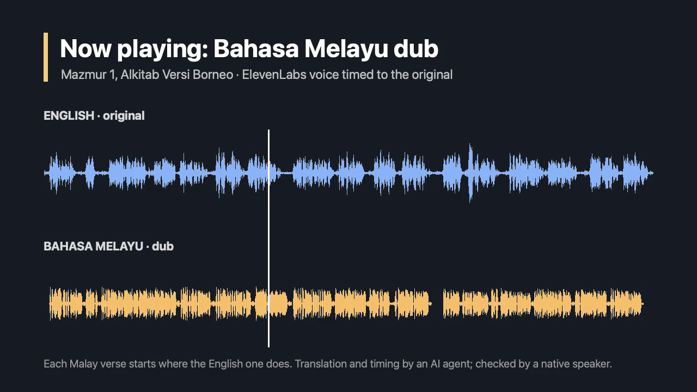
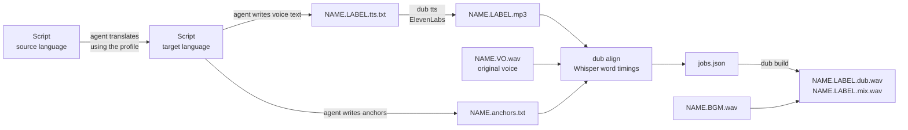

# dub-agent

[](https://github.com/gabrielmlow21/dub-agent/actions/workflows/tests.yml)

Dub a voice-over into another language with an AI agent. The agent translates the script, a TTS voice reads it, and `dub` times each section to where the original speaker said it and mixes it over the original music. The output is exactly as long as the original, so it drops straight back into the video.

It works for any language pair that [Whisper](https://github.com/ggerganov/whisper.cpp) can transcribe and [ElevenLabs](https://elevenlabs.io) can speak. Each client or language pair is a **profile**: a folder with its settings, glossary, style guide and its own rules for the agent. The steps themselves are a Claude Code skill shared by every profile. Adding a pair means adding a profile, not changing code.

It's used in production for Tagalog → Malaysian Malay church videos (see the [case study](#case-study-church-videos-into-malaysian-malay)).

## Demo

[](https://youtu.be/OWvdNPa1XdM)

**[Watch the before/after video on YouTube (1:50)](https://youtu.be/OWvdNPa1XdM)**, or [download the mp4](demo/DEMO_PS1.before-after.mp4). It plays Psalm 1 from a public-domain [LibriVox](https://archive.org/details/psalms_kjv_1202_librivox) King James reading, then the Malay dub made with the [`en-ms-bible`](profiles/en-ms-bible/) profile. The two waveforms are stacked so you can see each Malay verse start where the English one does.

How it was made, in one request to the agent:

1. Cut the clip from the LibriVox track: the heading "The Book of Psalms, King James Version" and Psalm 1 (55 s).
2. Took the Malay text from the Alkitab Versi Borneo (AVB) and applied the client's word swap, so "TUHAN" (the LORD) becomes "Tuan". "King James Version" became "Alkitab Versi Borneo", following the rule for version labels. The voice text and anchors are in [`demo/`](demo/).
3. Read it with ElevenLabs (48 s of Malay for 55 s of English), then ran `dub align` and `dub build`.
4. Checked the result by measuring where speech starts after each pause in both recordings. All eight sections start within 0.03 s of the English, and the dub matches the original's length (54.8 s) and loudness (−32.9 LUFS).

| Section | English starts | Malay starts |
|---|---|---|
| Kitab Mazmur, Alkitab Versi Borneo | 0.54 s | 0.55 s |
| Mazmur 1 | 3.81 s | 3.81 s |
| Verse 1 | 5.91 s | 5.94 s |
| Verse 2 | 15.50 s | 15.49 s |
| Verse 3 | 22.45 s | 22.45 s |
| Verse 4 | 35.93 s | 35.93 s |
| Verse 5 | 41.87 s | 41.88 s |
| Verse 6 | 49.12 s | 49.12 s |

Measuring it this way turned up two bugs that had made three of these sections start up to 1.6 s early. Both are fixed and covered by tests (see [Problems along the way](#problems-along-the-way)).

## How it works



1. **Translate.** The agent translates the script using the profile's glossary and style guide.
2. **Write the voice text.** The agent turns the translation into what the voice should actually say: no headings or production cues, references and acronyms spelled the way they're spoken.
3. **Read it aloud.** `dub tts` sends the text to ElevenLabs in chunks of whole paragraphs. It passes the text before and after each chunk so the voice's intonation carries across the joins.
4. **Line it up.** The agent writes one anchor per paragraph: the first few words of the translated paragraph and of the original (`Diberkatilah orang yang | Blessed is the man`). `dub align` transcribes both recordings with Whisper, finds each anchor in both, moves each start to where the speech after a pause begins, and flags weak matches.
5. **Build and mix.** `dub build` places each translated section at the original's start time. It slows a section by up to 15% or speeds it up by up to 25% to fit, and fills the rest with silence. It then brings the voice to the original voice's loudness and mixes it over the original music, as 48 kHz stereo.

## What the agent does and what a person does

| Step | Agent | Person |
|---|---|---|
| Translate the script | Writes the translation, applies the glossary and style guide | A native speaker reviews and approves it, and decides on new terms the agent proposes |
| New key terms | Proposes a glossary entry instead of silently picking one | Approves or changes it; the glossary is updated for every later script |
| Voice text | Writes it and reports anything odd, with the reading it used | Checks the call |
| Voice, timing, mix | Runs `tts`, `align` and `build`; fixes flagged anchors and re-runs | Listens to the result |
| Sections that end early | Reports any section ending more than ~1 s early | Decides whether to re-read it slower (`--speed`) |
| Missing files or API errors | Stops and asks | Supplies the file or fixes the account |

The [`dub` skill](.claude/skills/dub/SKILL.md) spells this out for the agent: the steps, what each of `align`'s warnings means and what to do about it, when to stop and ask, and what to report. It's in the repo, so Claude Code picks it up when you open the repo. To use it from other folders too, link it into your personal skills: `ln -s "$PWD/.claude/skills/dub" ~/.claude/skills/dub`. Each profile's `CLAUDE.md` adds that client's own rules, which win over the skill's defaults.

## Install

Needs `ffmpeg`, `whisper-cpp` and a Whisper model such as [`ggml-small.bin`](https://huggingface.co/ggerganov/whisper.cpp):

```bash
brew install ffmpeg whisper-cpp uv
```

Then install `dub`:

```bash
uv tool install git+https://github.com/gabrielmlow21/dub-agent@v0.2.1
```

To work on `dub` itself, install your local copy instead, so edits take effect straight away:

```bash
uv tool install --editable .
```

Run the tests (no audio, ffmpeg or Whisper needed):

```bash
uv run pytest
```

## Profiles

A profile is a folder, passed with `--profile DIR` (or the `DUB_PROFILE` environment variable):

| File | Read by | What it holds |
|---|---|---|
| `profile.toml` | `dub` | Languages, voice, output label, timing limits |
| `glossary.md` | the agent | Approved terms, built up script by script |
| `style-guide.md` | the agent | Language variety, quoted text, how to write the voice text |
| `CLAUDE.md` | the agent | The client's own rules, on top of the `dub` skill |
| `.env` (git-ignored) | `dub` | `ELEVENLABS_API_KEY`, and optionally `ELEVENLABS_VOICE_ID`, `WHISPER_MODEL` |

```toml
source_lang = "en"     # Whisper language code of the original voice
target_lang = "ms"     # Whisper language code of the dub
label       = "BM"     # output names: NAME.BM.dub.wav, NAME.BM.mix.wav
voice       = "..."    # ElevenLabs voice ID
```

Command-line options override the environment, which overrides the profile. Start a new profile by copying [`profiles/template/`](profiles/template/), and keep real clients' profiles in their own private repos.

## Usage

```bash
dub tts   --profile PROFILE NAME.BM.tts.txt NAME.BM.mp3
dub align --profile PROFILE NAME NAME.BM.mp3 NAME.VO.wav NAME.anchors.txt --bgm NAME.BGM.wav
dub build --profile PROFILE jobs.json
```

`dub analyze <audio> --lang <code>` prints the pauses and a timestamped transcript, for looking at a recording yourself.

In practice the agent runs these steps. The usual request is a link to the script plus the original voice track, and "dub it".

## Problems along the way

**Whisper's timestamps drifted on long recordings.** On reads over about 15 minutes, the word timings Whisper gave slowly slid away from the audio, so later sections were placed late. The cause was Whisper reusing context from earlier text; running it with `-mc 0` (no carried-over context) fixed it.

**Anchor phrases didn't match because Whisper splits words differently.** Whisper might hear "belas kasihan" as one token or three. `align` therefore compares the letters of the phrase with a sliding run of letters from the transcript, ignoring word boundaries. Each match gets a score, and anything under 0.75 is flagged for a person to check.

**A wrong anchor shows up as a section that's "too fast".** If an anchor lands on the wrong spot, its section suddenly needs far more than a 25% speed-up. `align` merges that section into the one before it and says so. Several merges in a row point straight at the bad anchor.

**Measuring with Whisper hid two timing bugs.** At first the demo was checked by transcribing the dub with Whisper, and every verse looked "within about 0.5 s". But Whisper's word times are often 0.5–0.9 s early themselves: it tends to put a word's start inside the silence before it. Measuring where speech actually starts after each pause showed three sections starting 0.7–1.6 s early. Both causes are now fixed, with a test for each:

- **Anchors matched one word early.** `align` searched word by word and stopped at the first position scoring over 90%. For "Diberkatilah orang yang", starting on the "1" of "Mazmur 1" already scored 95% ("1diberkatilaorangyang" is one character off), so it never tried the next word. It now looks two words past a good match before settling. In the demo, this had put verse 1 on the same pause as its heading. That made an empty section, which crashed `build`; `align` now also merges an anchor that lands at or before the previous one, as a safety net.
- **The nearest pause was sometimes a breath.** After finding an anchor, `align` moves its start to a pause in the audio. It used to take the nearest one. For verse 5, a breath mid-sentence ended 0.8 s before Whisper's time, slightly closer than the real pause 0.9 s after, so the Malay started 1.6 s early. Since Whisper runs early, `align` now takes the first pause that ends from 0.3 s before Whisper's time onwards.

**Songs and clips in the original.** A long silence in the original voice track (where a song or video clip plays) has to stay silent in the dub, not be filled by stretched speech. Any silence of 3 s or more ends the section it falls in, and `align` warns if one lands where it can't be handled.

## Case study: church videos into Malaysian Malay

The first client is a Filipino church with members in Malaysia. Its worship and teaching scripts are written in Tagalog, with an English column, in two-column Google Docs. The agent translates them into Malaysian Malay in the doc itself, keeping the verse headings bold and the key words of each verse highlighted, and then dubs the recording.

**Why a one-click dubbing tool wasn't enough:**

- **Indonesian creeps in.** Malaysian and Indonesian Malay share most words, but listeners hear the difference: *akaun*, not *akun*; *kereta*, not *mobil*.
- **The Bible text has to be exact.** Verses are quoted word for word from the Alkitab Versi Borneo, with the church's own word swaps on top.
- **The terms have to stay the same across dozens of scripts.** The glossary grows with every script, and the agent proposes new entries instead of picking silently.
- **The timing has to follow the speaker,** with songs and clips left silent.

**A word swap that had to happen in the right order.** The AVB uses "Allah" for God and "Tuhan" for Lord, but the church uses "Tuhan" for God and "Tuan" for Lord. Doing the swaps in the wrong order turns God into "Tuan". The church's style guide fixes the order: "Tuhan" → "Tuan" first, then "Allah" → "Tuhan".

**Results:**

- **About a dozen scripts translated and voiced since early October 2026,** counted from the ElevenLabs history. The longest are full sermon scripts of 13,000–18,000 characters, roughly 15–20 minutes of Malay audio each.
- **Time per script:** a 1–2 page script used to take about an hour: 20 minutes to translate, with Google Translate and then redoing the bold and highlights by hand, then about 20 minutes to record the voice-over myself and 20 more to sync it to the original in an audio editor. Now a full 16-minute sermon script (about 13,500 characters of Malay) goes from the Google Doc link to a finished, timed dub in under 25 minutes of agent time, measured from the session log. That run included fixing a timing bug in `dub` along the way. My review adds about 10–20 minutes, a light read of the Malay and a listen to the mix (an estimate, not yet timed). So the whole sermon, several times longer than those scripts, takes about 35–45 minutes, and I no longer record or sync anything.
- **Voice cost per script:** that sermon's read used 5,953 ElevenLabs credits for 13,529 characters, from the account's history. That's about $1.30 at the Creator plan's $22 for 100,000 credits, or roughly 8 cents per minute of Malay audio. The longest script (21 minutes, 18,448 characters) used 8,118 credits, about $1.80. The Claude subscription isn't counted.
- **In use:** the dubs are played at the church's private gatherings.

The church's own profile stays private. [`profiles/en-ms-bible/`](profiles/en-ms-bible/) is a public example of the same kind, used for the demo.

## Layout

| Path | What's in it |
|---|---|
| [`dub/cli.py`](dub/cli.py) | The `dub` command: `tts`, `analyze`, `align`, `build` |
| [`.claude/skills/dub/`](.claude/skills/dub/SKILL.md) | The `dub` skill: the agent's steps, checks and report |
| [`tests/`](tests/) | Tests for anchor matching, pause snapping, text chunking, profiles and `.env` loading |
| [`profiles/template/`](profiles/template/) | Blank profile to copy for a new client or language pair |
| [`profiles/en-ms-bible/`](profiles/en-ms-bible/) | English → Malaysian Malay, Bible content: the demo's profile |
| [`demo/`](demo/) | The before/after video and its inputs (voice text, anchors) |
| [`pyproject.toml`](pyproject.toml) | Package definition |

The demo audio is from LibriVox and is in the public domain. The code is under the [MIT licence](LICENSE).
